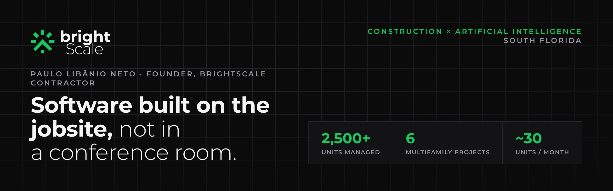
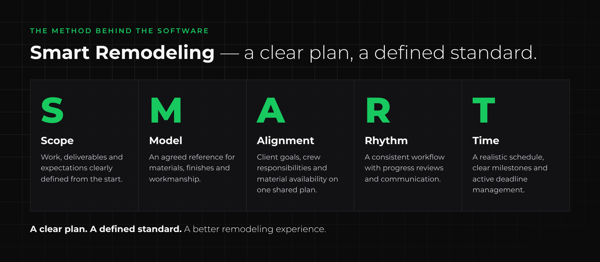

  

# Construction × AI — Product Portfolio

**Paulo Libânio Neto** · Founder, BrightScale Contractor · Project Manager, South Florida
Portuguese · English · Spanish · contact@brightscalegroup.com

I build software and AI systems for construction and home services, from the point of view of the person who has to deliver the job. Every product here started as a problem I had on a real project.

---

## Why this portfolio is different

| Jobsite experience | Product experience |
|---|---|
| 2,500+ units managed across 6 multifamily renovation projects | Production apps used on real jobs (PWA, Next.js, Supabase) |
| ~30 units/month completion pace across subcontracted crews | AI agents for phone, chat and lead intake |
| Hands-on trades: flooring, drywall, paint, stucco, carpentry, kitchens, baths | Retrieval-grounded assistants with deterministic safety rules |
| Creator of the **Smart Remodeling** method | Products that encode that method in software |

---

## Products

### 1. BrightScale Tracker — flagship for construction

Turns a signed estimate into one live plan for the homeowner, the designer and the crew: scopes, tasks, one subcontractor per scope, project financials and a progress link for the client. In use on BrightScale's own projects.
**[Launch page and screenshots →](https://github.com/libanius/BrightScale-Tracker)**

### 2. EOS — Emergency Operating System

Bilingual preparedness platform for families facing hurricanes, floods and grid failures. Live NWS/NHC/USGS hazards, a household-level supply model, an offline family plan, and an AI assistant whose rule-based verdict the model cannot override. The deepest codebase in the portfolio.
**[Launch page →](https://github.com/libanius/EOS-app)** · [Case study](./case-studies/EOS.md)

### 3. TimeTrack — crew hours and payroll
Offline-first PWA for check-ins by project and hourly rate, payroll reports, PDF export and GitHub backup.
**[Repository →](https://github.com/libanius/Time-tracker)** · [Case study](./case-studies/TimeTrack.md)

### 4. AI front office for contractors
Phone receptionist agents (Vapi + Google Calendar via Make.com) and a lead-capture bot that delivers qualified leads to the owner's phone on Telegram. Private builds.
[Case study: BrightScale AI Assistant](./case-studies/BrightScale-AI-Assistant.md)

### Concepts and earlier work
- **Lead Marketplace SaaS** — homeowners ↔ local pros, credit-based lead purchase · [Case study](./case-studies/Lead-Marketplace.md)
- **AbreUSA** — AI-guided onboarding for Brazilian entrepreneurs opening a U.S. company, with a long-term memory architecture · [Case study](./case-studies/AbreUSA-Memory-System.md)

---

## How I design AI systems

- **Rules before the model.** Anything safety- or money-critical is decided by deterministic logic; the model explains, it doesn't overrule.
- **Ground answers in real sources.** Curated knowledge bases and retrieval instead of open-ended generation.
- **Escalate to a human on purpose.** Agents know when to hand off, and pass a summary when they do.
- **Prove every claim.** Features are traced to tests before they appear in marketing.

Frameworks: [AI Evaluation Framework](./frameworks/AI-Evaluation-Framework.md) · [Prompt Design Framework](./frameworks/Prompt-Design-Framework.md)

---

## Work with me

- **SaaS:** BrightScale Tracker for remodelers, interior designers and property managers
- **Custom builds:** trackers, estimators, client portals and AI assistants shaped to your operation
- **Contact:** contact@brightscalegroup.com · 954-553-9535 · [brightscalegroup.com](https://www.brightscalegroup.com)
